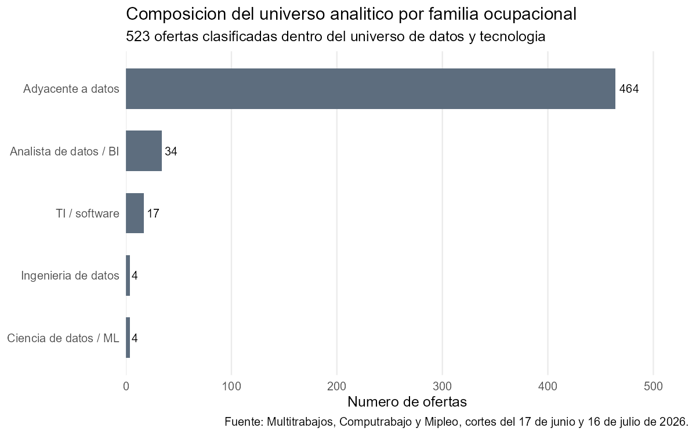
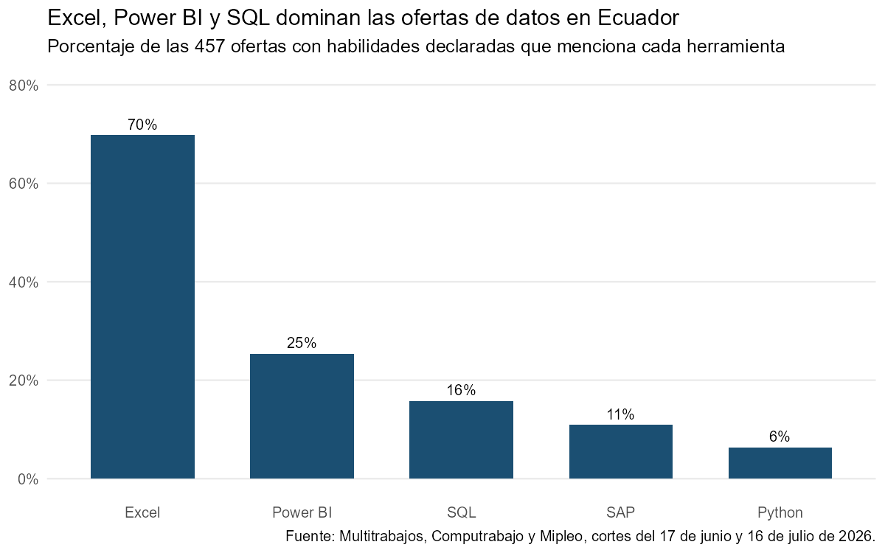
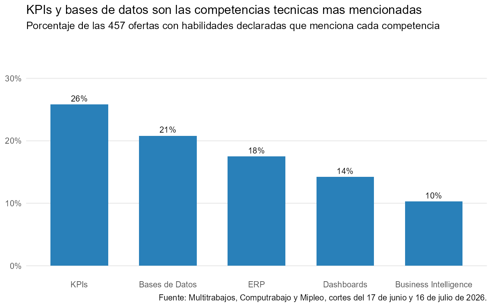

*En esta entrega del Quantificador, Daniel Sánchez analiza ofertas laborales públicas acumuladas entre el 17 de junio y el 26 de julio de 2026 en Multitrabajos, Computrabajo y Mipleo. La base muestra un patrón claro: en el mercado visible de datos en Ecuador, las empresas están buscando sobre todo perfiles para reportar, monitorear y ordenar información, mucho más que perfiles centrados en Python o machine learning.*

# El mercado público de datos en Ecuador se parece más a reportería que a ciencia de datos

La conversación sobre trabajo con datos suele estar dominada por Python, inteligencia artificial y modelos predictivos. Cuando uno mira vacantes públicas en Ecuador, la foto es bastante distinta.

Para este artículo acumulo tres cortes de ofertas publicados entre el 17 de junio y el 26 de julio de 2026 en Multitrabajos, Computrabajo y Mipleo. Después de juntar los cortes y eliminar duplicados, quedan 916 ofertas únicas. De ellas, 523 entran en el universo analítico de este proyecto y 457 declaran habilidades de manera explícita. Esa última submuestra es la base para leer qué herramientas y competencias aparecen con más frecuencia.

El primer hallazgo aparece antes de mirar una sola habilidad. De las 523 ofertas del universo analítico, 464 pertenecen a la familia `data_adjacent`. Es decir, 88,7% del total corresponde a puestos donde los datos importan, pero como parte de funciones comerciales, operativas, administrativas o de business intelligence más amplias. En cambio, las ofertas clasificadas como analista de datos o BI son 34. Las de ingeniería de datos son 4 y las de ciencia de datos o machine learning son otras 4.

Eso ya ordena la discusión. El mercado público visible sí está pidiendo trabajo con datos, pero lo está haciendo sobre todo para seguir indicadores, alimentar tableros, ordenar procesos y apoyar decisiones de negocio. El segmento abiertamente técnico existe, pero sigue siendo pequeño dentro de esta vitrina pública.

*Gráfico 1: Composición del universo analítico por familia ocupacional*

*Fuente: Multitrabajos, Computrabajo y Mipleo. Nota: el gráfico resume ofertas públicas acumuladas entre el 17 de junio y el 26 de julio de 2026, luego de eliminar duplicados entre cortes. El universo analítico incluye ofertas clasificadas por el pipeline como roles de datos, BI o funciones adyacentes a datos en Ecuador.*

# Excel manda con claridad y Python sigue en los márgenes

Cuando pasamos a las 457 ofertas que sí declaran habilidades, la jerarquía es contundente. Excel aparece en 319 ofertas, equivalente a 69,8% de la submuestra. Power BI aparece en 116, o 25,4%. SQL llega a 72, equivalente a 15,8%. SAP aparece en 50, o 10,9%. Python aparece en 29, apenas 6,3%.

No es una diferencia pequeña. Excel está presente en cerca de siete de cada diez ofertas con habilidades declaradas. Python aparece en alrededor de una de cada dieciséis. Si alguien quiere entender qué significa hoy "trabajar con datos" en la parte pública y visible del mercado ecuatoriano, la respuesta está mucho más cerca de hojas de cálculo, reportes y tableros que de programación avanzada.

Power BI sí ocupa un lugar importante, pero como segunda herramienta, no como eje del mercado. SQL aparece con cierta frecuencia, pero lejos de Excel. Python aparece como una habilidad de nicho dentro de esta muestra.

*Gráfico 2: Excel, Power BI y SQL dominan las ofertas públicas de datos en Ecuador*

*Fuente: Multitrabajos, Computrabajo y Mipleo. Nota: los porcentajes se calculan sobre 457 ofertas con habilidades declaradas, observadas entre junio y julio de 2026.*

Hay un dato adicional que ayuda a ubicar mejor el nivel técnico de estas vacantes. La combinación Excel y Power BI aparece en 90 ofertas, casi una de cada cinco. La combinación Power BI y SQL aparece en 40. La tríada Excel, Power BI y SQL aparece en 30, o 6,6% del total con habilidades declaradas. Ese grupo sí se parece más a un stack analítico consolidado, pero sigue siendo minoritario.

La conclusión práctica es bastante directa: el mercado visible no está organizado principalmente alrededor de puestos donde programar sea el centro del trabajo. Está organizado alrededor de puestos donde transformar información en seguimiento operativo sí lo es.

# Las competencias más pedidas hablan de control, seguimiento y gestión

El patrón se confirma cuando dejamos de lado las herramientas y miramos competencias más amplias. Las menciones más frecuentes son KPIs en 118 ofertas, bases de datos en 95, ERP en 80, dashboards en 65 y business intelligence en 47. En porcentaje sobre la submuestra con habilidades, eso equivale a 25,8%, 20,8%, 17,5%, 14,2% y 10,3%, respectivamente.

Este bloque dice bastante sobre el trabajo que las empresas esperan resolver con datos. Lo que aparece con más fuerza no es modelación, experimentación o aprendizaje automático. Lo que aparece es seguimiento de indicadores, consolidación de información, conexión con sistemas empresariales y visualización para la toma de decisiones cotidiana.

Dicho de otra forma, estas ofertas hablan el lenguaje de la gestión. Piden personas que sepan mantener tableros, ordenar bases, seguir metas, levantar alertas y traducir información en reportes útiles para ventas, operaciones o administración.

*Gráfico 3: KPIs y bases de datos lideran las competencias técnicas más mencionadas*

*Fuente: Multitrabajos, Computrabajo y Mipleo. Nota: los porcentajes se calculan sobre 457 ofertas con habilidades declaradas. Las categorías agrupan términos afines dentro del texto de las vacantes.*

# Quito y Guayaquil concentran la mayor parte del mercado visible

La concentración geográfica también es fuerte. Quito reúne 223 ofertas y Guayaquil 144. Juntas suman 367 de las 523 vacantes del universo analítico, equivalente a 70,2% del total. Cuenca aparece bastante más atrás con 42 ofertas.

Eso quiere decir que el mercado público visible de trabajo con datos sigue anclado, sobre todo, a los dos principales polos económicos del país. No estamos viendo una demanda dispersa en todo el territorio, sino un mercado fuertemente concentrado en las ciudades donde ya se agrupan empresas, servicios corporativos y funciones administrativas.

La modalidad de trabajo va en la misma dirección. De las 523 ofertas, 394 son presenciales, es decir, 75,3%. Otras 106 no especifican modalidad. Las híbridas son 14 y las remotas apenas 9.

En esta muestra, el empleo de datos tampoco aparece como un mercado ampliamente remoto. La oferta pública sigue siendo, en lo esencial, urbana y presencial.

# Las habilidades blandas refuerzan el perfil operativo de estas vacantes

Las habilidades blandas también forman parte del perfil que están pidiendo estas vacantes. No entran en el campo estructurado de habilidades. Aparecen en las descripciones de puesto, y por eso retratan directamente el tipo de trabajador que las empresas quieren contratar.

Los términos más repetidos en las descripciones son organización, que aparece en 246 ofertas, comunicación en 188, planificación en 123, proactividad en 108 y trabajo en equipo en 103. También destacan atención al detalle y pensamiento analítico.

Esto encaja con el resto del artículo. Las empresas no están buscando solamente a alguien que sepa abrir una base o mover datos en Excel. Están buscando perfiles que sostengan procesos, coordinen áreas, sigan indicadores, ordenen información y comuniquen resultados dentro de equipos de trabajo. Incluso en las vacantes más cercanas a datos, el perfil dominante es el de soporte analítico para la operación, no el de una persona aislada haciendo modelación técnica.

El punto metodológico aquí es simple: estas habilidades blandas se identifican por palabras clave dentro del texto de las ofertas. No son una lista exhaustiva de requisitos. Aun así, el patrón es claro. El mercado visible de datos en Ecuador está mucho más pegado a funciones de gestión, coordinación y seguimiento que a una lógica puramente técnica.

# ¿Qué cambia esta lectura del mercado de datos?

El resultado principal de este ejercicio es sencillo: en Ecuador, la puerta de entrada más visible al trabajo con datos no pasa primero por Python. Pasa por Excel, KPIs, bases de datos, Power BI y reportería.

Eso no vuelve irrelevantes a SQL, Python o machine learning. Sí ubica mejor su peso actual dentro del mercado público observable. Hoy funcionan como capas especializadas de una demanda más pequeña, mientras que el grueso de vacantes está resolviendo necesidades de control, seguimiento comercial, business intelligence y operación.

También cambia la forma de pensar la formación. Para una parte importante de estas vacantes, saber programar no sustituye saber ordenar información, construir indicadores, entender procesos de negocio y comunicar resultados. El mercado visible está pidiendo menos científicos de datos de lo que sugiere la conversación en redes y más perfiles capaces de sostener la infraestructura cotidiana de decisiones dentro de las empresas.

La siguiente tarea es seguir estos portales de manera continua, separar con más precisión los roles genuinamente analíticos de los adyacentes y medir cómo cambia la demanda cuando el universo se restringe a puestos más cercanos a BI, analítica e ingeniería de datos. Pero el diagnóstico general ya está sobre la mesa: la parte pública del mercado ecuatoriano de datos sigue siendo, sobre todo, un mercado de reportería, indicadores y visualización.

*Este artículo se elaboró con ofertas laborales públicas observadas en Multitrabajos, Computrabajo y Mipleo entre el 17 de junio y el 26 de julio de 2026. El repositorio con la base reproducible del análisis está disponible en [GitHub](https://github.com/dsanchezp18/quanti-jobs-scraping). La metodología de recolección se documenta por separado y no se publica en este repositorio.*

