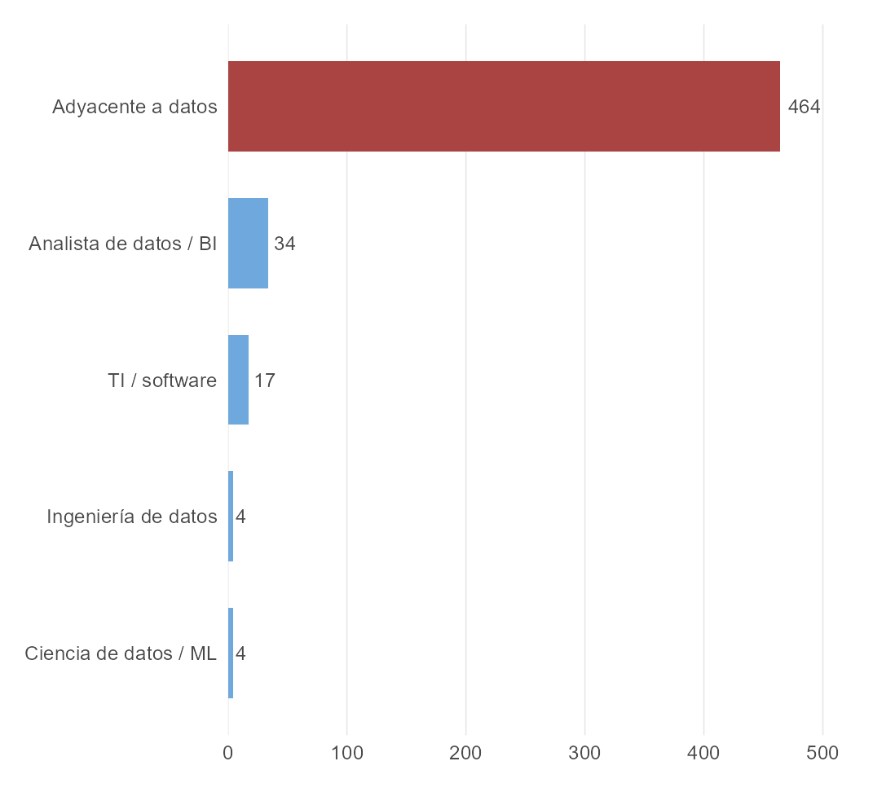
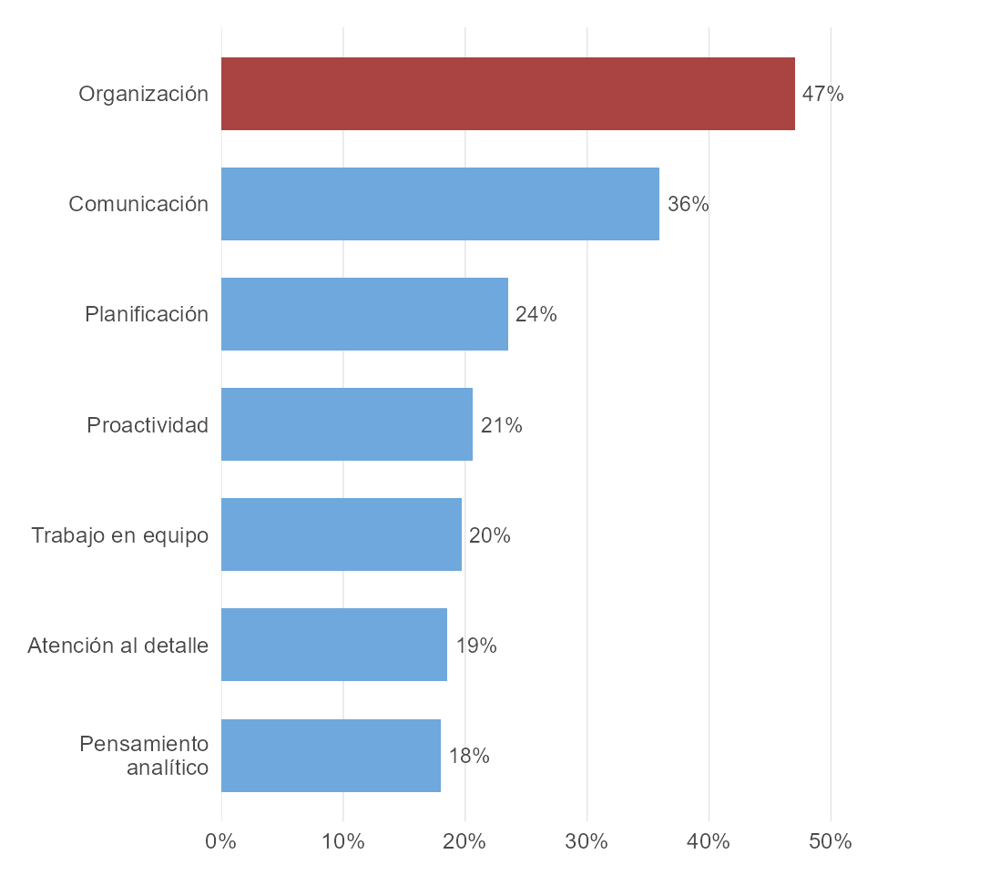

```{r setup, include=FALSE}
knitr::opts_chunk$set(echo = FALSE, out.width = "100%")
```

Edición Julio-Diciembre 2026

ISSN 2953-6456

*En esta entrega del Quantificador, Daniel Sánchez analiza ofertas laborales públicas acumuladas entre junio y julio de 2026 en Multitrabajos, Computrabajo y Mipleo. La base deja una conclusión clara: en el mercado visible de datos en Ecuador, los empleadores están buscando sobre todo perfiles para reportar, monitorear y ordenar información, mucho más que perfiles centrados en Python o machine learning. ¿Qué puede aprender de esto un profesional en formación? Bastante.*

La conversación sobre trabajo con datos suele estar dominada por Python, inteligencia artificial y modelos predictivos. Ese imaginario existe, pero no describe bien la parte pública del mercado laboral ecuatoriano. Cuando uno mira vacantes reales, la imagen es mucho más terrenal: Excel, reportería, indicadores, tableros y conocimiento de la operación.

En este artículo recopilo y organizo ofertas públicas para responder una pregunta simple: ¿qué quieren hoy los empleadores ecuatorianos cuando contratan perfiles vinculados a datos? Los hallazgos apuntan a tres cosas. Primero, el mercado visible sigue concentrado en tecnologías más básicas que avanzadas. Segundo, pesa mucho el conocimiento de negocio y de gestión. Tercero, las habilidades blandas sí importan, pero como complemento de un perfil operativo más que como sustituto de capacidades técnicas.

# El método deja ver un mercado todavía pequeño y poco especializado

La base de este artículo acumula tres cortes de ofertas públicas observadas entre el 17 de junio y el 26 de julio de 2026. En bruto, la base reúne 1.536 registros. Después de eliminar duplicados por portal y anuncio, quedan 916 ofertas únicas. De ellas, 523 entran en el universo analítico de este proyecto y 457 declaran habilidades de manera explícita.

La clasificación ocupacional del pipeline separa cinco grupos: analista de datos o BI, ciencia de datos o machine learning, ingeniería de datos, TI o software pesado y una categoría amplia de roles adyacentes a datos. Esta última incluye puestos donde el trabajo con información es importante, pero está incrustado en áreas comerciales, financieras, operativas o administrativas.

*Gráfico 1: Composición del universo analítico por familia ocupacional*

```{r grafico1}

```

*Fuente: Multitrabajos, Computrabajo y Mipleo. Nota: el gráfico resume ofertas públicas acumuladas entre el 17 de junio y el 26 de julio de 2026, luego de eliminar duplicados entre cortes. El universo analítico incluye ofertas clasificadas como roles de datos, BI o funciones adyacentes a datos en Ecuador.*

De las 523 ofertas del universo analítico, 464 pertenecen a la familia de trabajos adyacentes a datos. Eso representa 88,7% del total. Las ofertas clasificadas como analista de datos o BI son 34. Las de ingeniería de datos son 4 y las de ciencia de datos o machine learning son otras 4.

Eso dice dos cosas sobre el mercado laboral visible. La primera es que todavía es pequeño. La segunda es que está poco especializado. En Ecuador sí hay demanda por trabajo con datos, pero en la parte pública del mercado esa demanda aparece sobre todo mezclada con funciones de control, seguimiento, procesos, ventas, finanzas y soporte a decisiones.

# Excel domina sin rivales, seguido de Power BI y SQL

Cuando pasamos a las 457 ofertas que sí declaran habilidades, la jerarquía es muy clara. Excel aparece en 319 ofertas, equivalente a 69,8% de la submuestra. Power BI aparece en 116, o 25,4%. SQL llega a 72, equivalente a 15,8%. SAP aparece en 50, o 10,9%. Python aparece en 29, apenas 6,3%.

Eso quiere decir que Excel está presente en cerca de siete de cada diez ofertas con habilidades declaradas. La imagen del mercado visible no es la de un ecosistema dominado por programación avanzada. Lo que observamos es un mercado que necesita ordenar información, seguir indicadores, armar reportes y sostener tableros para la operación diaria.

Power BI y SQL ayudan a entender mejor ese punto. Power BI sirve para construir tableros y visualizaciones que vuelven legible la información para gerencias, equipos comerciales u operaciones. SQL sirve para consultar, limpiar y mover datos dentro de bases estructuradas. Este último es, de los tres, el más técnico.

En conjunto, estas son herramientas útiles para dar un paso más allá de Excel, pero todavía están subordinadas a una lógica de monitoreo y gestión, no a una lógica de modelación compleja. El combo de Excel, Power BI y SQL perfila al trabajador mejor preparado en el plano técnico dentro de este mercado visible.

*Gráfico 2: Excel, Power BI y SQL dominan las ofertas públicas de datos en Ecuador*

```{r grafico2}
knitr::include_graphics("images/grafico2.png")
```

*Fuente: Multitrabajos, Computrabajo y Mipleo. Nota: los porcentajes se calculan sobre 457 ofertas con habilidades declaradas, observadas entre junio y julio de 2026.*

El lugar de Python es todavía más revelador. Aparece en alrededor de una de cada dieciséis ofertas. Esa distancia no parece accidental. Sugiere al menos tres cosas: muchas empresas siguen en una etapa de reportería y control más que de analítica avanzada; los puestos más técnicos son pocos dentro de la vitrina pública; y parte de la contratación más sofisticada probablemente ocurre por canales menos visibles que los portales abiertos. Aun así, el hecho de que esa capa exista confirma algo sencillo: el mercado para esos puestos es mucho más pequeño que el mercado principal que estamos observando.

# Los empleadores quieren expertos en control, seguimiento y gestión

El patrón se confirma cuando dejamos de lado las herramientas y miramos competencias más amplias. Las menciones más frecuentes son KPIs en 118 ofertas, bases de datos en 95, ERP en 80, dashboards en 65 y business intelligence en 47. En porcentaje sobre la submuestra con habilidades, eso equivale a 25,8%, 20,8%, 17,5%, 14,2% y 10,3%, respectivamente.

Este bloque dice bastante sobre el trabajo que las empresas esperan resolver con datos. Lo que aparece con más fuerza no es modelación, experimentación o aprendizaje automático. Lo que aparece es seguimiento de indicadores, consolidación de información, conexión con sistemas empresariales y visualización para la toma de decisiones cotidiana. Esto no se traduce en dominar una herramienta específica, sino en dominar un conjunto de habilidades parecidas y poder aplicarlas dentro de un entorno de trabajo.

*Gráfico 3: KPIs y bases de datos lideran las competencias técnicas más mencionadas*

```{r grafico3}
knitr::include_graphics("images/grafico3.png")
```

*Fuente: Multitrabajos, Computrabajo y Mipleo. Nota: los porcentajes se calculan sobre 457 ofertas con habilidades declaradas. Las categorías agrupan términos afines dentro del texto de las vacantes.*

# Quito y Guayaquil concentran la mayor parte del mercado visible

La concentración geográfica también es fuerte. Quito reúne 223 ofertas y Guayaquil 144. Juntas suman 367 de las 523 vacantes del universo analítico, equivalente a 70,2% del total. Cuenca aparece bastante más atrás con 42 ofertas.

Eso significa que el mercado público visible de trabajo con datos sigue anclado, sobre todo, a los dos principales polos económicos del país. Estamos viendo un mercado concentrado allí donde ya se agrupan empresas, servicios corporativos y funciones administrativas.

# El trabajo remoto casi no aparece

La modalidad de trabajo va en la misma dirección. De las 523 ofertas, 394 son presenciales, es decir, 75,3%. Otras 106 no especifican modalidad. Las híbridas son 14 y las remotas apenas 9.

Eso rompe con una expectativa común en la conversación sobre empleo digital. La parte visible del mercado laboral de datos en Ecuador no luce remota, distribuida ni globalizada. Luce urbana, presencial y muy atada a la lógica organizacional tradicional.

¿Por qué se da esto? Una explicación plausible es que los empleadores ecuatorianos siguen teniendo bastante poder para fijar condiciones en un mercado laboral estancado. Cuando la oferta de profesionales es amplia y la demanda no despega con la misma fuerza, las empresas no solo pueden pagar menos por el mejor talento: también pueden exigir más presencialidad y menos flexibilidad. Un profesional buscando su nuevo reto debe tomar esto en cuenta. 

# Las habilidades blandas refuerzan el perfil operativo de estas vacantes

Las habilidades blandas también forman parte del perfil que están pidiendo estas vacantes. No entran en el campo estructurado de habilidades. Aparecen en las descripciones de puesto, y por eso retratan directamente el tipo de trabajador que las empresas quieren contratar.

Los términos más repetidos en las descripciones son organización, que aparece en 246 ofertas, comunicación en 188, planificación en 123, proactividad en 108 y trabajo en equipo en 103. También destacan atención al detalle y pensamiento analítico.

*Gráfico 4: Habilidades blandas más mencionadas en las descripciones de vacantes*

```{r grafico4}

```

*Fuente: Multitrabajos, Computrabajo y Mipleo. Nota: la identificación se basa en palabras clave dentro de las descripciones de puesto.*

Eso encaja con el resto del artículo. Las empresas no están buscando solamente a alguien que sepa abrir una base o mover datos en Excel. Están buscando perfiles que sostengan procesos, coordinen áreas, sigan indicadores, ordenen información y comuniquen resultados dentro de equipos de trabajo. Incluso en las vacantes más cercanas a datos, el perfil dominante es el de soporte analítico para la operación, no el de una persona aislada haciendo modelación técnica.

# ¿Qué significa esto para los profesionales en datos?

La lección más importante es que el mercado visible de datos en Ecuador no está pidiendo, en primer lugar, científicos de datos. Está pidiendo perfiles que ayuden a convertir información en control operativo. Eso cambia cómo conviene pensar la formación.

Primero, vale la pena dominar bien las herramientas básicas. Excel no es un paso menor ni una estación vergonzosa antes de lo importante. En este mercado, es una herramienta central. Lo mismo pasa con Power BI, SQL, reportería y manejo de indicadores.

Segundo, el conocimiento de negocio importa. Muchas de estas vacantes están insertas en ventas, finanzas, logística, administración y operaciones. Por eso no basta con saber mover datos, sino entender qué problema de empresa estás resolviendo y por qué ese dato importa dentro de un proceso real. ¿Qué significa esto en la práctica? Un profesional en formación puede aprovechar mucho pasantías, voluntariados o primeros trabajos para aprender más sobre el negocio en el que desea trabajar.

Tercero, las habilidades blandas no son un adorno. Comunicación, organización, trabajo en equipo y proactividad aparecen porque los analistas de datos no trabajan solos. Presentan hallazgos, coordinan áreas, empujan procesos y convierten información en decisiones comprensibles para otros. Un profesional en formación se beneficia mucho de estar cómodo en trabajo en equipo, presentaciones y comunicación escrita.

Por último, la ruta de entrada al sector no pasa necesariamente por empezar con lo más sofisticado. Para muchas personas, una pasantía o un primer rol de soporte analítico puede ser más valioso que perseguir de inmediato un puesto de machine learning que casi no aparece en los portales públicos. En este mercado, construir criterio de negocio y dominar lo básico parece abrir más puertas que obsesionarse demasiado pronto con la capa más avanzada del oficio.

# Notas metodológicas

Este artículo describe la parte pública y visible del mercado laboral, no el universo completo de contrataciones en Ecuador. La base reúne anuncios observados en tres portales, por lo que deja fuera procesos cerrados, referidos internos, headhunters y contrataciones que nunca llegan a publicarse de forma abierta.

Además, la clasificación de ocupaciones y habilidades es una construcción analítica del proyecto. Sirve para ordenar un mercado muy mezclado, pero no elimina toda la ambigüedad de anuncios que combinan tareas de datos con funciones comerciales, administrativas o de operación.

También hay límites importantes en variables clave. La información salarial aparece vacía o poco comparable en la mayoría de vacantes, así que este artículo no intenta estimar remuneraciones. Algo parecido ocurre con ciertas condiciones contractuales: no todos los portales publican el mismo nivel de detalle.

Aun con esos límites, la base sí permite responder la pregunta central del artículo. La parte visible del mercado laboral de datos en Ecuador está dominada por herramientas básicas, funciones de seguimiento y perfiles operativos. Ese resultado es suficientemente consistente como para tomárselo en serio.

*Este artículo se elaboró con ofertas laborales públicas observadas en Multitrabajos, Computrabajo y Mipleo entre el 17 de junio y el 26 de julio de 2026. El repositorio con la base reproducible del análisis está disponible en [GitHub](https://github.com/dsanchezp18/quanti-jobs-scraping).

